<picture>
  <source media="(prefers-color-scheme: dark)" srcset="./cards/hero-dark.svg" />
  
</picture>

<picture>
  <source media="(prefers-color-scheme: dark)" srcset="./cards/graph-dark.svg" />
  
</picture>

<picture>
  <source media="(prefers-color-scheme: dark)" srcset="./cards/activity-dark.svg" />
  
</picture>

<a href="https://github.com/jeevabharathi44/loan-eligibility-ai"><picture><source media="(prefers-color-scheme: dark)" srcset="./cards/tile-projects-dark.svg" /></picture></a>
<a href="https://github.com/jeevabharathi44?tab=repositories"><picture><source media="(prefers-color-scheme: dark)" srcset="./cards/tile-stack-dark.svg" /></picture></a>
<a href="https://www.linkedin.com/in/jeeva-bharathi-m-2592172ab"><picture><source media="(prefers-color-scheme: dark)" srcset="./cards/tile-connect-dark.svg" /></picture></a>

<a href="https://github.com/jeevabharathi44/loan-eligibility-ai"><picture><source media="(prefers-color-scheme: dark)" srcset="./cards/repo-loan-dark.svg" /></picture></a>
<a href="https://github.com/jeevabharathi44/driving-scenario-analyzer"><picture><source media="(prefers-color-scheme: dark)" srcset="./cards/repo-driving-dark.svg" /></picture></a>

---

  <strong>Education:</strong> B.E. CSE, Sri Ramakrishna Institute of Technology, Coimbatore (2023–2027) ·
  <strong>Internships:</strong> Blaze (Full Stack, Jun 2026) · Qono Technology (SWE, Jun 2025) ·
  <strong>Certs:</strong> NASSCOM AI/ML (Gold 98%) · NASSCOM Cloud (Gold 92%) ·
  <a href="https://www.linkedin.com/in/jeeva-bharathi-m-2592172ab">LinkedIn ↗</a>

